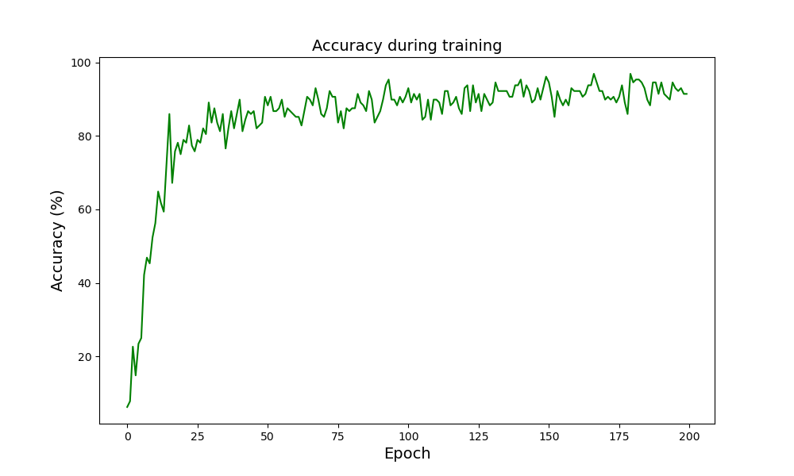

# Neural Network From Scratch (NumPy)

A modular neural network implementation built entirely from scratch using **Python and NumPy**, implementing the fundamental components of a feedforward neural network, including forward propagation, backpropagation, activation functions, loss functions and optimisation algorithms. The project demonstrates the underlying mathematics and mechanics of neural networks without relying on high-level deep learning frameworks such as PyTorch or TensorFlow.

This project is adapted from a NN implementation that was developed as part of an MSci project investigating [**Stochastic Randomisation And Neural Network Based Classification Of Knots In 3D Space**](https://drive.google.com/file/d/10OT540xMB-NDDF0PgPgucR_COFQMPtku/view?usp=sharing), in order to understand how neural networks work at a fundamental level by implementing their components from scratch, and was used to train models on large datasets of knot coordinates/writhes on the University of Birmingham's HPC cluster.

## Features

- **Modular architecture:** Neural networks are constructed by combining layers and activation functions.
- **Dense layers:** Fully connected layers with trainable weights and biases.
- **Activation functions:**
  - ReLU
  - Leaky ReLU
  - Tanh
  - Softmax
- **Loss functions:** Cross-entropy loss, Mean square error
- **Optimisation algorithms:**
  - Stochastic Gradient Descent (SGD)
  - SGD with Momentum
  - Adam
- **Mini-batch training:** Training using batches of samples.
- **Model persistence:** Saving and loading trained model parameters.
- **Data preprocessing:** Normalising data being fed into the model.

## Project Structure

This project uses the MNIST handwritten digit dataset in CSV format, downloaded from [Kaggle](https://www.kaggle.com/datasets/oddrationale/mnist-in-csv/data), uploaded by [oddrationale](https://www.kaggle.com/oddrationale).

After downloading, place the CSV files in the root directory:

```text
NN_numpy/
│
├── Functions/
│   ├── __init__.py
│   ├── activations.py
│   ├── base.py
│   ├── batches.py
│   ├── layers.py
│   ├── losses.py
│   ├── misc.py
│   ├── optimizers.py
│   ├── preprocessing.py
│   └── train_test.py
│
├── MNIST_NN.ipynb
├── train_new_model_MNIST.py
├── use_existing_model_MNIST.py
├── trained_model_MNIST.npz
├── train.csv
├── test.csv
├── XOR_test.py
└── README.md
```

### Core Modules

| Module | Description |
|---|---|
| `layers.py` | Implements neural network layers, including fully connected (Dense) layers. |
| `activations.py` | Implements activation functions and their derivatives. |
| `losses.py` | Implements loss functions and their gradients. |
| `optimizers.py` | Implements SGD, SGD with Momentum and Adam. |
| `batches.py` | Handles mini-batch generation during training. |
| `preprocessing.py` | Data preprocessing utilities. |
| `train_test.py` | Training and testing functionality. Can be adapted to other datasets. |
| `base.py` | Base class for layers. |
| `misc.py` | Miscellaneous utility functions (e.g. saving a trained model). |

## MNIST Classification

The project includes an implementation of a neural network trained to classify handwritten digits from the [MNIST dataset](https://en.wikipedia.org/wiki/MNIST_database).

The network consists of:
- An input layer accepting 784 features (28 × 28 pixels).
- A hidden Dense layer with 256 neurons and ReLU activation.
- An output Dense layer with 10 neurons and Softmax activation.

### Network Architecture

```text
Input (784)
     |
Dense (784 → 256)
     |
    ReLU
     |
Dense (256 → 10)
     |
   Softmax
     |
Output (10 classes)
```

### Training Configuration

| Parameter | Value |
|---|---|
| Input features | 784 |
| Hidden neurons | 256 |
| Output classes | 10 |
| Batch size | 128 |
| Optimizer | Adam |
| Learning rate | 0.001 |
| Loss function | Cross-Entropy |
| Epochs | 200 |

Pixel values are normalised to the range [0, 1], and the digit labels are converted to one-hot encoded vectors.

### Results

The trained model [trained_model_MNIST.py](trained_model_MNIST.py) was tested on 5000 examples from test.csv and had an accuracy of 91.92%.

This is a plot of the reported accuracy during the model's training:



### Running the MNIST Example

To train a new model:

```bash
python train_new_model_MNIST.py
```

To load and use an existing trained model:

```bash
python use_existing_model_MNIST.py
```

The trained model is saved in NumPy's `.npz` format, allowing its parameters to be reused. The architecture is also saved inside the same archive as a string.

## XOR Classification

The repository also includes `XOR_test.py`, which demonstrates the network's ability to learn the XOR function.

### Network Architecture

```text
Input (2)
     |
Dense (2 → 8)
     |
    ReLU
     |
Dense (8 → 1)
     |
    Sigmoid
     |
Output (1)
```
The number of neurons in the hidden layer can be changed from 8 to 4, but the network then becomes sensitive to the weight initialisation and sometimes fails to reach an accuracy of 100%.

## Installation

### Requirements

- Python
- NumPy
- Pandas (for the MNIST CSV examples)

Clone the repository:

```bash
git clone https://github.com/Ahmedg2v/NN_numpy.git
cd NN_numpy
```

Install the dependencies:

```bash
pip install numpy pandas
```
